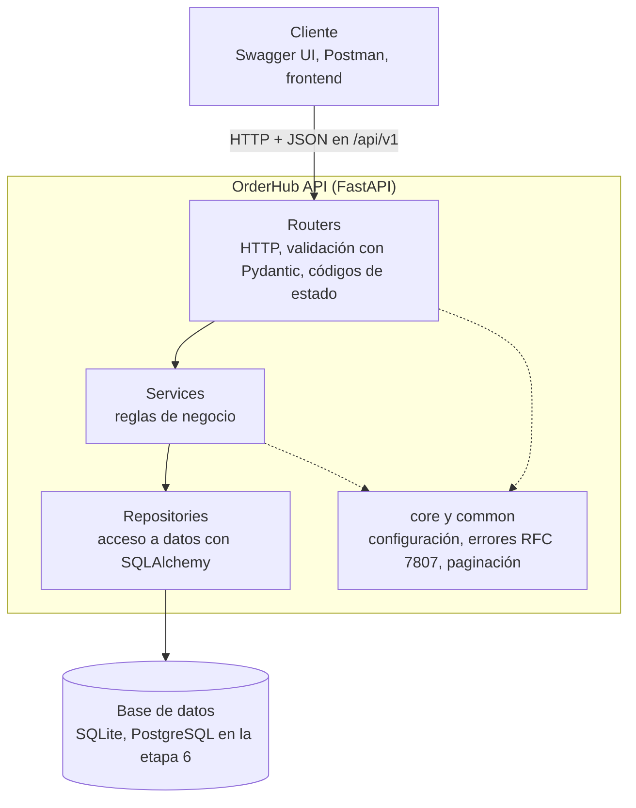
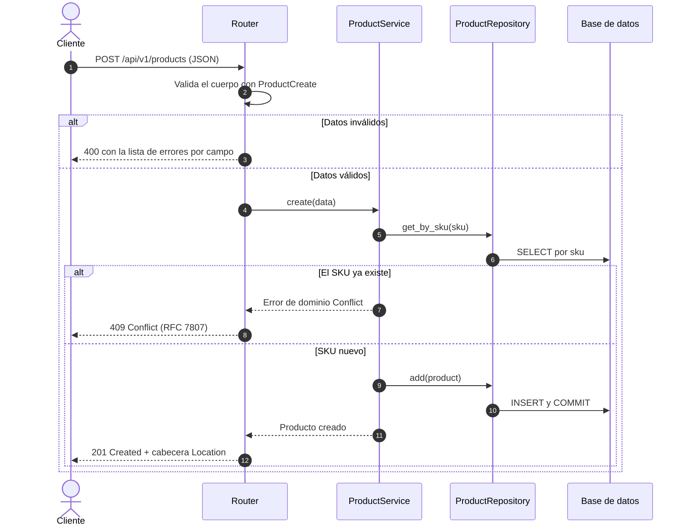
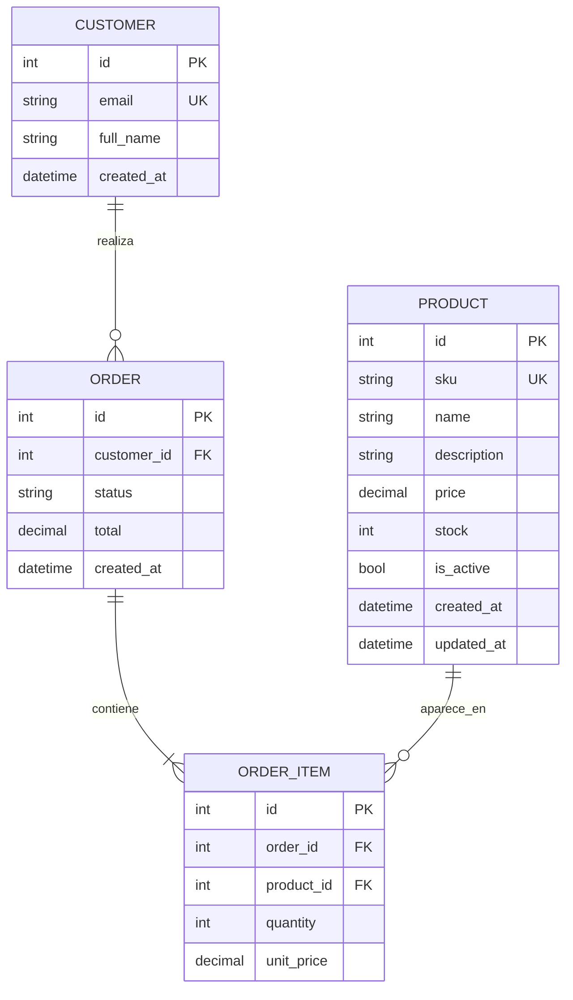
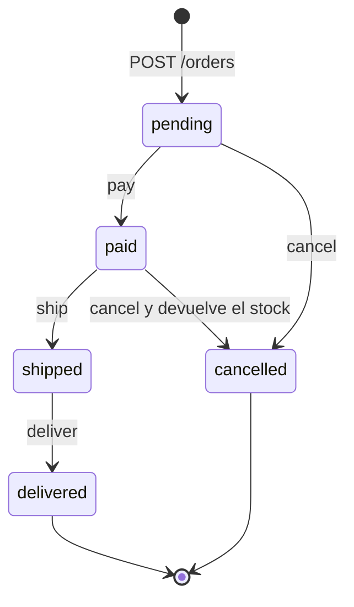

# OrderHub API

RESTful order management API built with **FastAPI**: products, customers and orders.
Construida paso a paso, desde "Hola mundo" hasta una arquitectura en capas lista para crecer.

## Diseño arquitectónico

### Vista general: arquitectura en capas

Cada petición atraviesa las capas siempre en la misma dirección, de arriba hacia abajo.
Cada capa tiene un solo trabajo.



| Capa | Responsabilidad | Lo que NO hace |
|---|---|---|
| **Router** | Recibir la petición, validar la entrada, devolver el código HTTP correcto | Decidir reglas de negocio o escribir SQL |
| **Service** | Aplicar las reglas: SKU único, stock suficiente, transiciones de estado | Conocer HTTP (lanza errores de dominio, no `HTTPException`) |
| **Repository** | Leer y escribir en la base de datos | Decidir si una operación está permitida |
| **core / common** | Configuración, formato de errores, paginación compartida | — |

### Flujo de una petición: crear un producto



### Modelo de datos



- **Implementado:** `PRODUCT`. **Etapa 4:** `CUSTOMER`, `ORDER` y `ORDER_ITEM`.
- `ORDER_ITEM.unit_price` copia el precio al momento de la compra: si el producto cambia de
  precio, los pedidos antiguos no cambian.
- El dinero usa `Decimal` / `Numeric(10, 2)`, nunca `float`.

### Ciclo de vida de un pedido (etapa 4)



Cualquier transición que no aparece en el diagrama responde `409 Conflict`.

### Estructura del código

```
app/
├── main.py                    # create_app(): registra routers y manejadores de errores
├── core/
│   ├── config.py              # configuración por variables de entorno (ORDERHUB_*)
│   └── errors.py              # errores de dominio → respuestas RFC 7807
├── db/session.py              # conexión, sesión y dependencia get_db
├── common/pagination.py       # Page[T], PageParams, ordenamiento con lista blanca
└── modules/
    └── products/
        ├── router.py          # capa HTTP
        ├── service.py         # reglas de negocio
        ├── repository.py      # acceso a datos
        ├── schemas.py         # contrato de la API (Pydantic)
        └── models.py          # tabla (SQLAlchemy)
```

Las decisiones de diseño (ADRs) y las convenciones de la API están en
[`docs/ARQUITECTURA.md`](docs/ARQUITECTURA.md).

## Cómo está organizado este repositorio

Este proyecto está pensado para **aprender construyendo**. Sigue este orden:

**1. Lecciones** ([`lecciones/`](lecciones/README.md)): 9 archivos pequeños; cada uno enseña
un concepto de FastAPI (rutas, parámetros, Pydantic, respuestas, CRUD, dependencias, base de
datos y tests).

**2. Etapas del proyecto**: la API de productos construida **tres veces**, cada vez mejor.
Cada etapa es un tag de git, así que puedes ver y comparar el código de cada una:

| Etapa | Tag | Qué cambia | Por qué |
|---|---|---|---|
| 1 | `etapa-1` | Todo en `app/main.py`, datos en memoria | Ver una API completa de un vistazo |
| 2 | `etapa-2` | SQLite + SQLAlchemy, código en 4 archivos | Los datos sobreviven a los reinicios |
| 3 | `etapa-3` | Capas: router, service, repository | Cada parte tiene un solo trabajo |

```bash
git checkout etapa-1          # ver el código de la etapa 1
git diff etapa-1 etapa-2      # ver exactamente qué cambió entre etapas
git checkout main             # volver a la versión más reciente
```

Lo importante: **`tests/test_products.py` es idéntico en las tres etapas.** La estructura
interna cambia por completo, pero el contrato de la API no, y los tests lo demuestran.

## Puesta en marcha

```bash
python -m venv .venv
source .venv/bin/activate          # Windows: .venv\Scripts\activate
pip install -r requirements.txt

uvicorn app.main:app --reload      # documentación interactiva: http://localhost:8000/docs
pytest -q                          # tests de la API
```

## Prueba rápida

```bash
# Crear un producto -> 201 + cabecera Location
curl -i -X POST localhost:8000/api/v1/products -H "Content-Type: application/json" \
  -d '{"sku": "POLO-001", "name": "Polo básico", "price": "39.90", "stock": 50}'

# Repetirlo -> 409 Conflict (SKU duplicado)

# Buscar, filtrar, ordenar y paginar
curl "localhost:8000/api/v1/products?search=polo&in_stock=true&sort=-price&page=1&size=10"

# Modificar solo el precio
curl -X PATCH localhost:8000/api/v1/products/1 -H "Content-Type: application/json" \
  -d '{"price": "35.00"}'

# Error con formato estándar (RFC 7807)
curl -i localhost:8000/api/v1/products/999
```

## Endpoints actuales

| Método | Ruta | Respuestas |
|---|---|---|
| POST | `/api/v1/products` | 201, 400, 409 |
| GET | `/api/v1/products` | 200, 422 (filtros: `search`, `min_price`, `max_price`, `in_stock`; `sort`; `page`, `size`) |
| GET | `/api/v1/products/{id}` | 200, 404 |
| PATCH | `/api/v1/products/{id}` | 200, 400, 404 |
| DELETE | `/api/v1/products/{id}` | 204, 404 |
| GET | `/health` | 200 |

## Ejercicios antes de la etapa 4

Escribe primero el test y luego el código.

1. **Filtro por estado:** añade `is_active=true|false` al listado de productos.
2. **Desactivar en lugar de borrar:** `POST /products/{id}/deactivate`; responde `409` si ya
   estaba inactivo.
3. **Regla de negocio:** no se puede bajar el precio más de un 50% en un solo PATCH (`422`).
   ¿En qué capa va esta regla? (Respuesta: en el service.)
4. **Nuevo campo:** `category` con valores permitidos (Enum) y filtro en el listado.
   Recuerda borrar `orderhub.db` para que se cree la columna nueva.

## Próximas etapas

- **Etapa 4. Pedidos:** clientes, pedidos con varias líneas, control de stock, totales,
  máquina de estados (`pending → paid → shipped → delivered`, `cancelled`).
- **Etapa 5. Seguridad:** registro, login con JWT, roles `customer` y `admin`.
- **Etapa 6. Producción:** Docker, PostgreSQL, migraciones con Alembic, logs estructurados.
